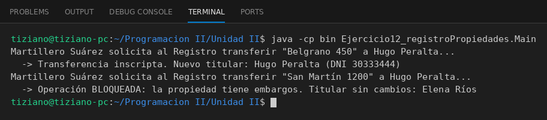

# RegistroPropiedad

Programación II - Unidad 2 - Ejercicio 12

## Consigna
Un gestor inmobiliario solicita al registro transferir una propiedad, que solo se concreta si no hay embargos.

## Lógica
- `Propietario` (DNI, nombre) y `Propiedad` (dirección, tasación, estado legal y propietario).
- `RegistroPropiedad.transferirInmueble(p, nuevoTitular)`: si la propiedad está EMBARGADA retorna `false`; si no, cambia el propietario y retorna `true`.
- `GestorInmobiliario.gestionarTraspaso(...)`: intermediario que envía el mensaje al registro e informa el resultado.
- `Main`: una transferencia exitosa y otra bloqueada por embargo.

## Ejecución

